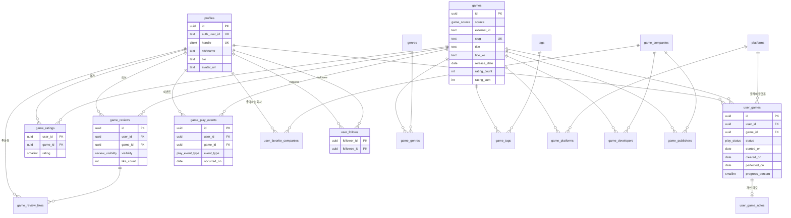

# 데이터 모델

- 근거: [기능 명세서](../product/feature-specification.md), [REA 기능 분석](../rea/feature-analysis.md)
- DB: Neon Lakebase Postgres. 인증 사용자는 Neon Auth가 `neon_auth` 스키마에서 관리하고, 앱 테이블은 `public` 스키마에 둔다.
- 별칭: 요구사항의 `users` 엔티티는 **Neon Auth 사용자 + 앱의 `profiles`**로 구현한다.

## 1. 설계 원칙

1. **게임 메타데이터와 사용자 기록을 분리한다.** `games`는 모두가 공유하고, `user_games`·`game_ratings`·`game_reviews`·`game_play_events`는 사용자 소유다.
2. **평가 · 라이브러리 · 리뷰 · 달력 이벤트는 각각 별도 테이블**이며 서로 외래키로 묶지 않는다. `(user_id, game_id)`로만 만난다.
3. 평가 여부·리뷰 여부는 저장하지 않고 조인으로 계산한다.
4. 날짜(`started_on` 등)는 `user_games`가 **원본**이고 `game_play_events`는 거기서 파생된 로그(+ 사용자가 직접 추가한 플레이 기록)다.
5. 의도적인 비정규화는 두 곳뿐이다: `games.rating_count/rating_sum`, `game_reviews.like_count`. 읽기가 압도적으로 많고 트리거로 일관성을 유지한다.
6. 개인 메모는 행 단위 RLS로 보호하기 위해 별도 테이블로 분리한다.

## 2. ERD

## 3. 열거형

| 이름 | 값 |
|---|---|
| `game_source` | `igdb`, `manual` |
| `play_status` | `interested`(관심 있음), `planned`(플레이 예정), `playing`(플레이 중), `paused`(일시 중단), `cleared`(엔딩 완료), `perfected`(100% 달성), `dropped`(플레이 포기) |
| `progress_kind` | `percent`, `text` (확장: `chapter`, `checklist`, `custom`) |
| `review_visibility` | `public`, `private` |
| `play_event_type` | `library_added`, `play_started`, `ending_reached`, `completed_100`, `rated`, `reviewed`, `play_session` |
| `event_source` | `derived`(트리거 생성), `manual`(사용자 입력) |

## 4. 테이블 명세

### 4.1 사용자

**`profiles`** — Neon Auth 사용자와 1:1
| 컬럼 | 타입 | 제약 |
|---|---|---|
| `id` | uuid | PK, `gen_random_uuid()` |
| `auth_user_id` | text | UNIQUE NOT NULL — Neon Auth 사용자 ID(타입 차이를 흡수하려고 uuid PK와 분리) |
| `handle` | citext | UNIQUE NOT NULL, `^[a-z0-9_]{3,20}$` |
| `nickname` | text | NOT NULL, 1–20자 |
| `bio` | text | ≤ 200자 |
| `avatar_url` | text | |
| `created_at`, `updated_at` | timestamptz | |

**`user_follows`** — PK(`follower_id`, `followee_id`), 둘 다 `profiles.id` FK(ON DELETE CASCADE), `CHECK (follower_id <> followee_id)`, 인덱스 `(followee_id, created_at DESC)`.

### 4.2 게임 메타데이터

**`games`**
| 컬럼 | 타입 | 제약·비고 |
|---|---|---|
| `id` | uuid | PK |
| `source` | game_source | NOT NULL |
| `external_id` | text | IGDB 게임 ID. `UNIQUE (source, external_id) WHERE external_id IS NOT NULL` |
| `slug` | text | UNIQUE NOT NULL |
| `title`, `title_ko` | text | `title` NOT NULL. 표시는 `coalesce(title_ko, title)` |
| `summary` | text | |
| `release_date` | date | |
| `cover_url` | text | |
| `cover_width`, `cover_height` | int | 원본 비율 유지용 |
| `created_by` | uuid | 수동 등록자 FK, IGDB는 NULL |
| `rating_count`, `rating_sum` | int | 기본 0, 트리거로 유지. 평균 = `rating_sum / rating_count / 2` |
| `metadata_synced_at` | timestamptz | IGDB 동기화 시각 |
| `created_at`, `updated_at` | timestamptz | |

인덱스: `GIN (title gin_trgm_ops)`, `GIN (title_ko gin_trgm_ops)`, `(release_date DESC)`, `(rating_count DESC, id)`.

**분류·연결**
| 테이블 | 컬럼 | 비고 |
|---|---|---|
| `platforms` | `id` smallint PK, `slug` UNIQUE, `name`, `igdb_id` | 시드: PC, PS5, PS4, Switch, Xbox Series, Xbox One, iOS, Android |
| `genres` | `id` smallint PK, `slug` UNIQUE, `name` | 기본 분류. 시드는 명세 H절 |
| `tags` | `id` int PK, `slug` UNIQUE, `name`, `source` | 세부 특징. 사용자·IGDB가 추가 가능 |
| `game_companies` | `id` uuid PK, `slug` UNIQUE, `name`, `name_ko`, `igdb_id` UNIQUE NULL, `country` | 게임과 별도. 검색용 trigram 인덱스 |
| `game_genres` / `game_tags` / `game_platforms` | PK(`game_id`, `genre_id`/`tag_id`/`platform_id`) | N:M |
| `game_developers` / `game_publishers` | PK(`game_id`, `company_id`) | **개발사와 퍼블리셔를 별도 테이블로 구분**, 한 게임에 여러 회사 가능 |

### 4.3 사용자 기록

**`user_games`** — 라이브러리 (사용자가 등록한 게임과 진행 상황)
| 컬럼 | 타입 | 제약·비고 |
|---|---|---|
| `id` | uuid | PK |
| `user_id`, `game_id` | uuid | FK, **UNIQUE (user_id, game_id)** |
| `status` | play_status | NOT NULL |
| `platform_id` | smallint | FK NULL |
| `added_at` | timestamptz | 시스템. 게임 등록일 |
| `started_on`, `cleared_on`, `perfected_on` | date | 사용자 입력, NULL 허용 |
| `last_played_on` | date | 시스템 갱신 + 수동 수정 |
| `playtime_minutes` | int | `CHECK >= 0` |
| `progress_kind` | progress_kind | 기본 `percent` |
| `progress_percent` | smallint | `CHECK BETWEEN 0 AND 100` |
| `progress_text` | text | ≤ 100자 |
| `updated_at` | timestamptz | |

제약: `CHECK (cleared_on IS NULL OR started_on IS NULL OR cleared_on >= started_on)`. **상태 전환 제약은 두지 않는다**(자유 전환). 인덱스: `(user_id, status, updated_at DESC)`, `(user_id, last_played_on DESC)`, `(user_id, cleared_on DESC) WHERE cleared_on IS NOT NULL`.

**`user_game_notes`** — 개인 메모(비공개): PK `user_game_id` → `user_games.id` ON DELETE CASCADE, `note` text ≤ 2,000자.

**`game_ratings`** — 평가
| 컬럼 | 타입 | 제약 |
|---|---|---|
| `user_id`, `game_id` | uuid | **PK (user_id, game_id)** — 중복 평가 방지 |
| `rating` | smallint | `CHECK BETWEEN 1 AND 10` (별점 × 2, REA와 동일) |
| `created_at`, `updated_at` | timestamptz | |

인덱스: `(game_id)`, `(user_id, updated_at DESC)`.

**`game_reviews`** — 리뷰
| 컬럼 | 타입 | 제약·비고 |
|---|---|---|
| `id` | uuid | PK |
| `user_id`, `game_id` | uuid | **UNIQUE (user_id, game_id)**. 평가와 FK 없음 |
| `body` | text | 1–5,000자 |
| `has_spoiler` | boolean | 기본 false |
| `visibility` | review_visibility | 기본 `public` |
| `like_count` | int | 기본 0, 트리거로 유지 |
| `created_at`, `updated_at` | timestamptz | |

인덱스: `(game_id, visibility, like_count DESC, id)`, `(game_id, visibility, created_at DESC, id)`, `(user_id, created_at DESC)`.

**`game_review_likes`** — PK(`review_id`, `user_id`) → 중복 좋아요 방지. 인덱스 `(user_id)`.

**`user_favorite_companies`** — PK(`user_id`, `company_id`), `created_at`. 사용자당 최대 20개는 앱에서 검사한다.

### 4.4 달력·피드 이벤트

**`game_play_events`**
| 컬럼 | 타입 | 비고 |
|---|---|---|
| `id` | uuid | PK |
| `user_id`, `game_id` | uuid | FK |
| `event_type` | play_event_type | |
| `occurred_on` | date | 달력의 날짜 |
| `occurred_at` | timestamptz | 피드 정렬용 |
| `source` | event_source | `derived` / `manual` |
| `minutes` | int | `play_session`일 때 플레이 시간 |
| `note` | text | `play_session` 메모, ≤ 200자 |
| `is_public` | boolean | 기본 true. 비공개 리뷰 이벤트는 false |

제약: **`UNIQUE (user_id, game_id, event_type) WHERE event_type <> 'play_session'`** — 마일스톤 이벤트는 사용자·게임당 1개. 인덱스: `(user_id, occurred_on)`(달력), `(user_id, occurred_at DESC, id DESC)`(피드·프로필).

#### 이벤트 동기화 트리거

| 원본 변경 | 이벤트 처리 |
|---|---|
| `user_games` INSERT | `library_added` 생성(`occurred_on = added_at`). **`started_on`/`cleared_on`/`perfected_on`이 NULL이 아니면 `play_started`/`ending_reached`/`completed_100`도 함께 upsert** — 등록과 동시에 날짜를 입력해도 달력에 나타난다 |
| `user_games.started_on/cleared_on/perfected_on` UPDATE | 값이 있으면 `play_started`/`ending_reached`/`completed_100`을 upsert(`occurred_on` 갱신), NULL이면 삭제 |
| `user_games` DELETE | 해당 사용자·게임의 `library_added`·`play_started`·`ending_reached`·`completed_100`·`play_session` 삭제. **`rated`·`reviewed`는 유지** |
| `game_ratings` INSERT / DELETE | `rated` 생성 / 삭제 (UPDATE는 이벤트 없음) |
| `game_reviews` INSERT / DELETE | `reviewed` 생성 / 삭제 |
| `game_reviews.visibility` UPDATE | `reviewed.is_public` 동기화 |
| `play_session` | 사용자가 직접 INSERT/DELETE (`source = manual`) |

별도 트리거: `game_ratings` 변경 → `games.rating_count/rating_sum` 증감, `game_review_likes` 변경 → `game_reviews.like_count` 증감.

## 5. RLS 정책

앱은 `BYPASSRLS`가 없는 `app_user` 역할로 접속하고, 요청마다 트랜잭션 안에서 `set_config('app.user_id', <profile uuid>, true)`와 `set_config('app.auth_user_id', <auth id>, true)`를 설정한다. 모든 테이블에 `ENABLE ROW LEVEL SECURITY`를 적용한다. 마이그레이션·시드는 소유자 역할로 실행하고, **IGDB 가져오기만 별도의 `catalog_writer` 역할**(카탈로그 테이블 INSERT·UPDATE만 가능, 사용자 기록 테이블 접근 불가)로 실행한다.

`me() = nullif(current_setting('app.user_id', true), '')::uuid`

| 테이블 | SELECT | INSERT / UPDATE / DELETE |
|---|---|---|
| `profiles` | 모두 | INSERT: `auth_user_id = current_setting('app.auth_user_id', true)`. UPDATE: `id = me()` |
| `games`, 분류·회사·연결 테이블 | 모두 | `app_user`는 **읽기 전용**이며 예외는 수동 등록뿐이다. `games`는 `source = 'manual' AND created_by = me()`인 행만 INSERT·UPDATE, 연결 테이블은 해당 게임의 `created_by = me()`일 때만, `game_companies`·`tags`는 `igdb_id IS NULL`인 수동 행 INSERT만 허용한다. IGDB 가져오기는 `catalog_writer`가 수행한다 |
| `user_games` | 모두 | `user_id = me()` |
| `user_game_notes` | 소유자(`user_games.user_id = me()`) | 소유자 |
| `game_ratings` | 모두 | `user_id = me()` |
| `game_reviews` | `visibility = 'public' OR user_id = me()` | `user_id = me()` |
| `game_review_likes` | 모두 | `user_id = me()` 그리고 대상 리뷰의 작성자가 `me()`가 아님 |
| `user_follows` | 모두 | INSERT·DELETE: `follower_id = me()` (자기 팔로우는 CHECK로 차단) |
| `user_favorite_companies` | 모두 | `user_id = me()` |
| `game_play_events` | `is_public OR user_id = me()` | 사용자는 `source = 'manual'`이고 `event_type = 'play_session'`, `user_id = me()`인 행만. 파생 이벤트는 트리거(함수 소유자 권한)만 |

앱 서버에서도 모든 Server Action마다 세션을 확인하고 소유권을 검사한다. **RLS는 서버 버그에 대비한 두 번째 방어선**이다. 테스트는 사용자 A의 컨텍스트로 B의 행을 수정·삭제할 때 0행 또는 오류가 나는지 확인한다.

## 6. 대표 쿼리

| 용도 | 쿼리 요지 | 인덱스 |
|---|---|---|
| 달력(한 달) | `WHERE user_id = $1 AND occurred_on >= $2 AND occurred_on < $3` 후 날짜·타입별 집계 | `(user_id, occurred_on)` |
| 월간 통계 | 같은 범위에서 `GROUP BY event_type` + `SUM(minutes)` | 〃 |
| 라이브러리 | `WHERE user_id = $1 AND status = ANY($2)` + 키셋 `(정렬키, id)` | `(user_id, status, updated_at DESC)` |
| 게임 검색 | `title ILIKE` / `similarity(...)` + 키셋 | trigram GIN |
| 리뷰 목록 | `WHERE game_id = $1 AND (visibility='public' OR user_id=me())` 정렬 `like_count DESC, id` | 리뷰 인덱스 |
| 피드 | `WHERE user_id IN (내 팔로잉) AND is_public AND event_type <> 'play_session' AND (occurred_at, id) < ($cursor)` | `(user_id, occurred_at DESC, id DESC)` |
| 평균 평점 | `rating_sum::numeric / nullif(rating_count,0) / 2` | `games` 행 |

## 7. 무결성 매트릭스

| 요구사항 | 보장 방법 |
|---|---|
| 사용자별 평가 중복 방지 | `game_ratings` PK(user_id, game_id) |
| 사용자별 라이브러리 중복 방지 | `user_games` UNIQUE(user_id, game_id) |
| 팔로우 중복·자기 팔로우 방지 | `user_follows` PK + CHECK |
| 리뷰 좋아요 중복 방지 | `game_review_likes` PK(review_id, user_id) |
| 권한 없는 수정 방지 | 서버 인가 + RLS |
| 삭제·수정 정합성 | 트리거(이벤트·카운터), FK `ON DELETE CASCADE`(사용자·게임 삭제 시 기록 정리) |
| 평가·상태·리뷰 독립 | 서로 FK 없음, 트리거가 다른 도메인의 행을 만들지 않음 |

## 8. 시드

`platforms`, `genres`(15개), 기본 `tags`, 대표 회사(Nintendo, Atlus, FromSoftware, Capcom, Square Enix, Bandai Namco, Koei Tecmo, SEGA, Ubisoft, Electronic Arts), 개발용 샘플 게임 20여 개.

## 9. 후속 확장 여지

- 진행도 이력: `user_game_progress_logs(user_game_id, recorded_at, kind, value)`
- 리뷰 댓글: `review_comments`
- 알림: `notifications`
- 컬렉션: `collections`, `collection_games`
