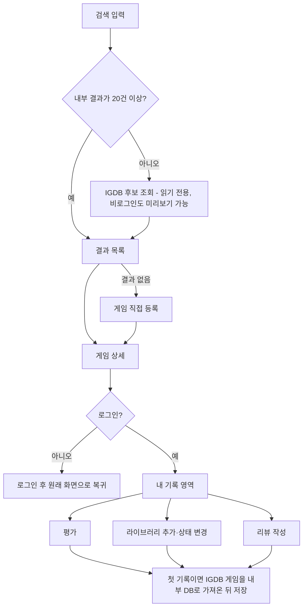
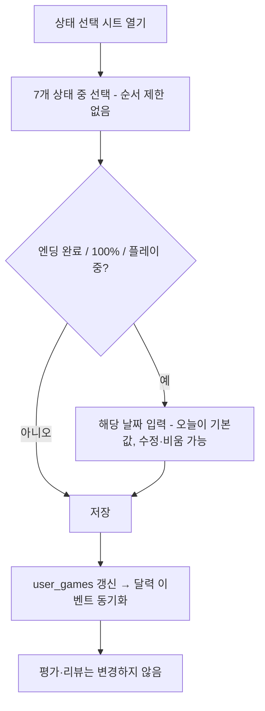

# 페이지 구조와 사용자 플로우

근거: [REA 페이지 분석](../rea/page-analysis.md), [UI 패턴](../rea/ui-patterns.md). 기능 규칙은 [기능 명세서](feature-specification.md)를 따른다.

## 1. 내비게이션

REA에서 왓챠피디아는 로그인 후 `홈 / 검색 / 캘린더 / 피드 / 나의 왓챠` 5탭을 쓴다. SavePoint는 같은 5탭 구조에서 **피드를 홈 상단 탭으로 옮기고 라이브러리를 승격**한다.

| 탭 | 경로 | 비고 |
|---|---|---|
| 홈 | `/` | 상단 탭 `발견 / 팔로잉` (팔로잉 = 소셜 피드) |
| 검색 | `/search` | |
| 라이브러리 | `/library` | |
| 달력 | `/calendar` | |
| 프로필 | `/u/{내 handle}` | 비로그인은 `로그인`으로 표시. 프로필 화면이 생기는 9단계 전까지는 로그인 상태에서 `내 계정`(`/account`)으로 간다 |

- 하단 내비는 모바일에서 고정한다. `lg` 이상에서는 같은 5개 항목을 좌측 세로 내비로 바꾼다.
- 활성 탭은 아이콘 채움 + 굵은 라벨 + 상단 2px 선으로 구분한다(색에 의존하지 않음).
- 비로그인 사용자는 홈·검색·게임 상세·공개 프로필을 볼 수 있고, 라이브러리·달력·쓰기 동작은 로그인으로 보낸다. `/auth/sign-in?redirectTo=<원래 경로>`.

## 2. 라우트 맵

| 경로 | 화면 | 접근 |
|---|---|---|
| `/` | 홈 | 공개 |
| `/search` | 게임 검색 | 공개 |
| `/games/{slug}` | 게임 상세 | 공개 (내 기록 영역은 로그인) |
| `/games/new` | 게임 수동 등록 | 로그인 |
| `/genres/{slug}`, `/tags/{slug}` | 장르·태그별 게임 목록 | 공개 |
| `/companies/{slug}` | 회사 상세(개발작·퍼블리싱작) | 공개 |
| `/library` | 내 라이브러리 | 로그인 |
| `/calendar`, `/calendar/{YYYY}/{MM}` | 월간 달력 | 로그인 |
| `/calendar/{YYYY}/{MM}/{DD}` | 일별 기록 | 로그인 |
| `/calendar/{YYYY}` | 연도별 조회 | 로그인 |
| `/u/{handle}` | 프로필 | 공개 |
| `/u/{handle}/ratings`, `/reviews` | 평가·리뷰 목록 | 공개 |
| `/u/{handle}/followers`, `/following` | 팔로워·팔로잉 | 공개 |
| `/settings/profile` | 프로필 수정 | 로그인 |
| `/auth/sign-in`, `/auth/sign-up` | 인증 | 공개 |

필터·정렬·월은 URL에 담아 공유와 새로고침에 안전하게 한다(REA UI 패턴 §1).

## 3. 화면 구조 (우선 설계 8개)

### 3.1 홈
```
[로고]                         [검색]
발견 | 팔로잉
─────────────────────
인기 게임        (가로 레일: 커버 → 아래에 게임명·평균)
최근 등록 게임   (가로 레일)
출시 예정        (가로 레일)
─────────────────────
[홈][검색][라이브러리][달력][프로필]
```
`팔로잉` 탭은 피드(J4). 비로그인이면 로그인 안내 한 줄.

### 3.2 게임 검색
```
[ 검색 입력                ] [취소]
게임 | 회사 | 유저
─────────────────────
(빈 상태) 인기 게임 목록
(결과)    게임 카드 그리드 2열 → 더 보기(커서)
(없음)    "검색 결과가 없어요."  [게임 직접 등록하기]
```

### 3.3 게임 상세
```
← 게임명                         공유
[커버 이미지 (원본 비율)]
게임명 / 출시 연도 · 장르 링크
개발사 · 퍼블리셔 · 플랫폼 · 태그(링크)
평균 4.2 (1,234)
─── 내 기록 ──────────────────
평가   ☆☆☆☆☆  [평가 취소]
상태   [플레이 중 ▾]  진행도 [60%] 텍스트
날짜   시작 2026-11-01 · 엔딩 — · 100% —
       [리뷰 쓰기]
─── 소개 ─────────────────────
─── 리뷰 (좋아요 순 ▾ · 전체/팔로잉) ──
─── 관련 게임 ─────────────────
```
커버 위에 텍스트를 올리지 않는다. 내 기록 영역은 상세 상단 가까이에 둔다(REA: 별점이 상단).

### 3.4 평가·리뷰 작성
- **평가**: 별 5개 슬라이더(`role="slider"`). 탭·방향키로 0.5 단위 선택 → 즉시 저장 → `평가 취소` 활성.
- **리뷰 작성**: 전체 화면 시트. 본문 입력, `스포일러 포함` 체크, 공개 범위 라디오(공개/비공개), `저장`. 평가가 있으면 위에 별점 칩으로 표시하고 없으면 "평가는 선택이에요" 한 줄과 별 입력을 보여준다.

### 3.5 내 라이브러리
```
라이브러리                            [+ 게임 추가]
[전체][플레이 중][플레이 예정][엔딩 완료][100%][평가함][리뷰함]
정렬 [최근 등록 ▾]  필터 [장르][플랫폼]
행(밀도 우선): [썸네일] 게임명 · 상태 · 진행도 · ★4.0
```
정보 밀도가 필요한 화면이라 여백보다 사용성을 우선한다(목록 행 표준 48px를 썸네일 행으로 확장).

### 3.6 게임 기록 달력
```
←  2026년 11월 ▾  →              [이번 달]
이 달: 시작 3 · 엔딩 1 · 100% 0 · 리뷰 2 · 평가 5 · 12시간
[전체][시작][엔딩][100%][리뷰][평가][기록]
일 월 화 수 목 금 토
 1  2  3 ...   (칸: 이벤트 아이콘 최대 3 + 개수)
```
- 날짜 → 일별 기록(`/calendar/YYYY/MM/DD`): "11월 8일 · 4건" + 행 목록(썸네일·게임명·이벤트 레이블) + 하단 고정 버튼 2개 `플레이 기록 추가`(주) · `게임 추가하기`(보조).
  - `플레이 기록 추가`: 선택한 날짜로 고정된 시트가 열리고, 내 라이브러리에서 게임을 고른 뒤 플레이 시간·메모를 입력해 `플레이 기록`(`play_session`)을 만든다.
  - `게임 추가하기`: 검색으로 게임을 골라 라이브러리에 등록한다. 시작일이 그 날짜로 채워진 상태 시트가 열리며 확정해야 저장된다.
- 월 제목 → 연도·월 선택 시트. 연도 보기: 12개월 목록과 월별 건수.
- 키보드: 화살표로 날짜 이동, Enter로 일별 기록, PageUp/PageDown으로 월 이동.

### 3.7 사용자 프로필
```
[아바타] 닉네임              (본인) [프로필 수정]
자기소개                      (타인) [팔로우]
팔로워 11 · 팔로잉 8
평가 536 · 리뷰 90 · 엔딩 41 · 100% 7     (IBM Plex Mono)
좋아하는 게임회사  [Atlus] [FromSoftware] ...
최근 평가 / 최근 리뷰 / 최근 플레이 기록 (미니 달력)
```

### 3.8 팔로워·팔로잉
제목(`팔로워` / `팔로잉`) + 사용자 행(아바타·닉네임·[팔로우|팔로잉] 버튼). 자기 자신 행에는 버튼이 없다.

## 4. 핵심 플로우

### 4.1 검색 → 상세 → 기록



### 4.2 상태 변경과 엔딩 기록



요점: 저장 전에는 아무것도 기록되지 않는다. 날짜를 비우고 저장하면 이벤트가 만들어지지 않는다.

### 4.3 평가

1. 별을 탭하거나 방향키로 값을 고른다 → 즉시 저장(낙관적 업데이트, 실패 시 원복과 오류 문구).
2. 같은 값을 다시 고르거나 `평가 취소`를 누르면 삭제된다.
3. 평가는 라이브러리 상태에 영향을 주지 않는다. 라이브러리에 없는 게임도 평가할 수 있다.

### 4.4 리뷰

1. 상세의 `리뷰 쓰기` → 시트에서 본문·스포일러·공개 범위 → 저장.
2. 평가 없이 저장할 수 있다. 평가가 있으면 별점 칩이 함께 표시된다.
3. 수정·삭제는 본인만 가능하다. 삭제해도 평가는 남는다.

### 4.5 달력 탐색

`달력` → 이번 달 → 날짜 선택 → 일별 기록 → 이벤트 선택 → 게임 상세. 월 제목으로 시트를 열어 다른 달·연도로 이동하고, 이벤트 종류 칩으로 좁힌다. 일별 기록 화면의 `플레이 기록 추가`로 그날의 플레이 시간과 메모를 남길 수 있다.

### 4.6 팔로우와 피드

프로필에서 `팔로우` → 홈 `팔로잉` 탭에 해당 사용자의 활동이 나타난다. 언팔로우하면 이후 피드에서 빠진다. 사용자 검색은 검색 화면의 `유저` 탭.

### 4.7 좋아하는 게임회사

프로필 → `좋아하는 게임회사` 편집 → 회사 검색 → 추가/삭제(최대 20). 회사가 없으면 새로 등록한다.

## 5. 상태별 화면 차이

| 화면 | 비로그인 | 로그인(본인) | 로그인(타인 프로필) |
|---|---|---|---|
| 게임 상세 내 기록 | `로그인하고 기록하기` | 평가·상태·날짜·리뷰 | — |
| 프로필 | 공개 정보 | `프로필 수정`, 비공개 리뷰 포함 | `팔로우`, 공개 정보만 |
| 하단 내비 | 프로필 칸이 `로그인` | 5탭 | 5탭 |
